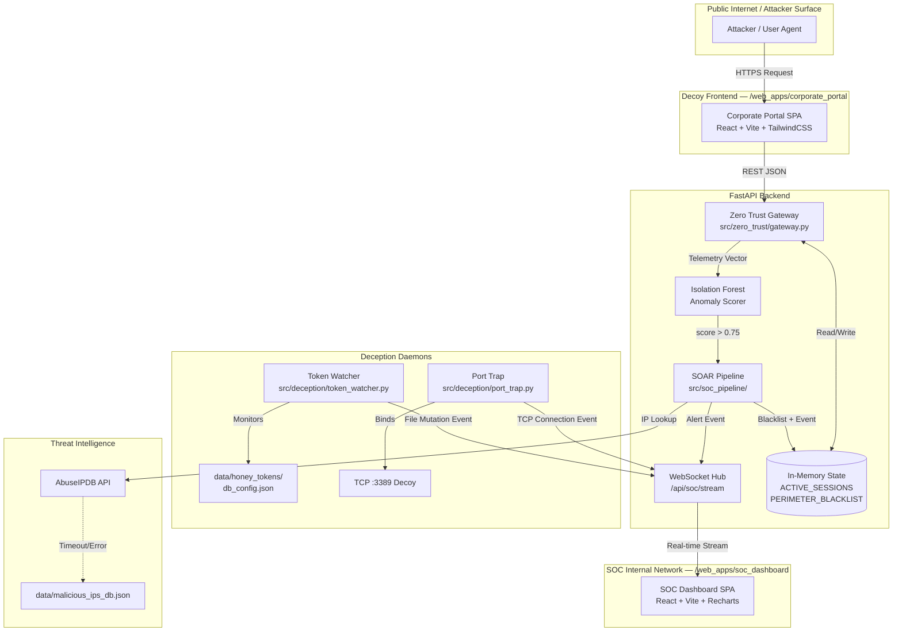
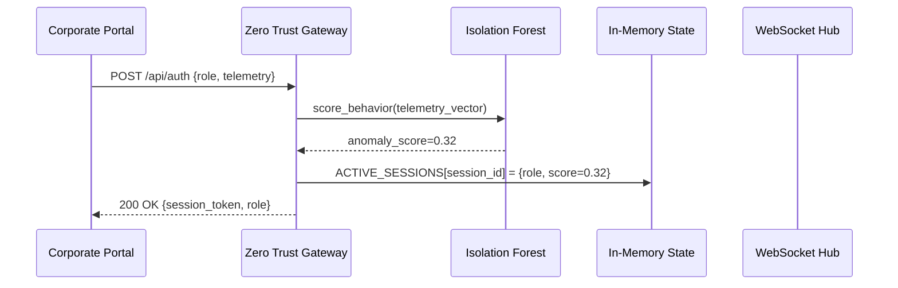
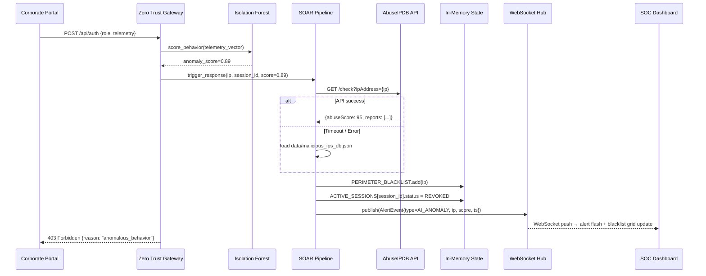
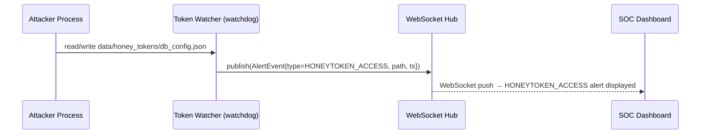
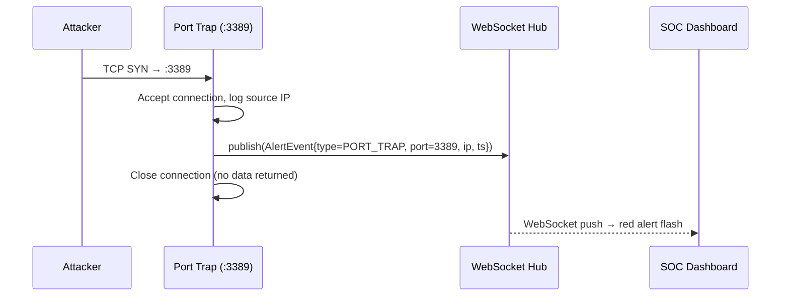

# Design Document: Project A.C.E.S.
## Automated Cybersecurity & Deception System

## Overview

Project A.C.E.S. is a full-stack, production-ready cybersecurity deception and monitoring system built on a completely decoupled React-FastAPI architecture. The system operates through three coordinated subsystems: a Zero Trust AI gateway that scores inbound user behavior in real time, a suite of passive deception daemons (honeytokens and port traps) that catch intruders silently, and a real-time SOC dashboard fed by a persistent WebSocket stream. All operational state — sessions, blacklists, risk scores — lives exclusively in RAM with zero database disk-write dependencies, ensuring low-latency response and forensic deniability.

The dual-frontend design exposes a convincing public-facing corporate decoy portal that funnels attackers into observable traps, while a local-only private SOC console gives analysts millisecond-precision alert telemetry, live blacklist management, and SOAR-automated threat response. An async AbuseIPDB integration enriches threat intelligence on flagged IPs with a graceful offline fallback to a pre-populated local threat database.

The system is designed for deployment in adversarial environments where stealth, speed, and deception fidelity are primary concerns. All secrets are injected via environment variables and no credentials are ever hardcoded or persisted to disk.


---

## Architecture

### High-Level System Architecture



### Repository Structure

```
project-aces/
├── requirements.txt                   # Unified backend dependencies
├── src/
│   ├── main.py                        # FastAPI app, startup/shutdown lifecycle, CORS config
│   ├── config.py                      # Environment variable loading and startup validation
│   ├── zero_trust/
│   │   ├── __init__.py
│   │   ├── gateway.py                 # AI middleware + Zero Trust enforcement
│   │   ├── scorer.py                  # IsolationForest BehaviorScorer
│   │   ├── models.py                  # Core enums and dataclasses
│   │   └── validation.py              # TelemetryVector field validation
│   ├── deception/
│   │   ├── __init__.py
│   │   ├── token_watcher.py           # Watchdog honeytoken file monitor
│   │   └── port_trap.py               # TCP :3389 RDP decoy server
│   └── soc_pipeline/
│       ├── __init__.py
│       ├── event_hub.py               # asyncio.Queue WebSocket broadcaster
│       ├── soar.py                    # SOAR automation + AbuseIPDB integration
│       └── ws_handler.py              # WebSocket /api/soc/stream endpoint
├── data/
│   ├── honey_tokens/
│   │   └── db_config.json             # Decoy credential file (bait)
│   └── malicious_ips_db.json          # Offline IP threat intel fallback
├── web_apps/
│   ├── corporate_portal/              # Public decoy React SPA (Vite + Tailwind)
│   └── soc_dashboard/                 # Private SOC React SPA (Vite + Tailwind + Recharts)
└── .env.example                       # Environment variable template
```


---

## Sequence Diagrams

### Flow 1: Normal User Authentication through Zero Trust Gateway



### Flow 2: High-Risk Attacker Triggering SOAR Pipeline



### Flow 3: Honeytoken File Access Detected



> **Note**: The TokenWatcher does NOT add any IP to PERIMETER_BLACKLIST. Filesystem events carry no network IP address (Requirement 6.5). Blacklisting only occurs via the PortTrap (network IP available) and the SOAR Engine (from Gateway scoring).

### Flow 4: Port Trap Connection on TCP :3389




---

## Components and Interfaces

### Component 1: Zero Trust Gateway (`src/zero_trust/gateway.py`)

**Purpose**: Acts as the single entry point for all inbound requests from the Corporate Portal. Extracts telemetry from each request, scores it with the Isolation Forest model, enforces Zero Trust policy decisions (allow / escalate / block), and manages the in-memory session registry.

**Interface**:
```python
class ZeroTrustGateway:
    async def process_request(
        self,
        request: InboundRequest,
        session_registry: dict,
        blacklist: set
    ) -> GatewayDecision: ...

    def score_behavior(
        self,
        telemetry: TelemetryVector
    ) -> float: ...  # Returns AnomalousBehaviorScore [0.0, 1.0]

    async def enforce_policy(
        self,
        ip: str,
        session_id: str,
        score: float
    ) -> PolicyResult: ...
```

**Responsibilities**:
- Extract client IP and telemetry payload from every inbound request
- Vectorize telemetry into a numeric feature array for the ML model
- Invoke `score_behavior()` and attach the score to the session record
- Route to SOAR pipeline when `score > 0.75`
- Check `PERIMETER_BLACKLIST` before processing any request (instant 403 on match)
- Write new sessions to `ACTIVE_SESSIONS` with role, IP, score, and timestamp

---

### Component 2: Isolation Forest Anomaly Scorer

**Purpose**: Unsupervised ML model embedded within the gateway that computes a normalized anomaly score from behavioral telemetry. Trained on a synthetic "normal" baseline at startup; no labeled data required.

**Interface**:
```python
class BehaviorScorer:
    def __init__(self, n_estimators: int = 100, contamination: float = 0.05): ...

    def fit(self, baseline_vectors: list[TelemetryVector]) -> None: ...

    def predict(self, telemetry: TelemetryVector) -> float:
        """Returns AnomalousBehaviorScore normalized to [0.0, 1.0]."""
        ...
```

**Responsibilities**:
- Accept a `TelemetryVector` (click intervals, path weights, sequence transitions)
- Return a score in `[0.0, 1.0]` where values closer to `1.0` indicate higher anomaly likelihood
- Normalize the raw Isolation Forest decision function output to `[0.0, 1.0]`

---

### Component 3: Event Hub (`src/soc_pipeline/event_hub.py`)

**Purpose**: A thread-safe `asyncio.Queue`-backed publish/subscribe bus. Any subsystem (gateway, token watcher, port trap) enqueues alert events; the WebSocket handler consumes and broadcasts them to all connected SOC clients.

**Interface**:
```python
class EventHub:
    async def publish(self, event: AlertEvent) -> None: ...
    async def subscribe(self) -> AsyncIterator[AlertEvent]: ...
    def get_queue(self) -> asyncio.Queue: ...
```

**Responsibilities**:
- Maintain a single shared `asyncio.Queue` instance (singleton)
- Accept `AlertEvent` objects from any coroutine or thread (using `loop.call_soon_threadsafe` for thread-to-async bridging)
- Fan-out each event to all active WebSocket subscriber coroutines

---

### Component 4: Token Watcher (`src/deception/token_watcher.py`)

**Purpose**: A multi-threaded `watchdog` filesystem monitor that watches `data/honey_tokens/db_config.json` for any read, write, or access event. On detection, publishes an alert and blacklists the offending process's source context.

**Interface**:
```python
class HoneytokenWatcher:
    def __init__(self, watch_path: str, event_hub: EventHub): ...
    def start(self) -> None: ...
    def stop(self) -> None: ...
    def on_any_event(self, event: FileSystemEvent) -> None: ...
```

**Responsibilities**:
- Run in a background daemon thread separate from the asyncio event loop
- Detect `FileCreatedEvent`, `FileModifiedEvent`, `FileAccessedEvent` on the honeytoken file
- Bridge detected events into the async `EventHub` using `call_soon_threadsafe`
- Publish `HONEYTOKEN_ACCESS` alerts with the affected file path; never add any IP to `PERIMETER_BLACKLIST` (filesystem events carry no network IP address)

---

### Component 5: Port Trap (`src/deception/port_trap.py`)

**Purpose**: An async TCP socket server bound to port 3389 (RDP decoy). It accepts incoming connections, logs the source IP, publishes an alert to the event hub, then immediately closes the connection — returning nothing to the attacker.

**Interface**:
```python
class PortTrap:
    def __init__(self, port: int, event_hub: EventHub): ...
    async def start_server(self) -> None: ...
    async def handle_connection(
        self,
        reader: asyncio.StreamReader,
        writer: asyncio.StreamWriter
    ) -> None: ...
```

**Responsibilities**:
- Bind a TCP server to port 3389 within the asyncio event loop
- Log source IP and timestamp for every inbound connection attempt
- Publish a `PORT_TRAP` alert event to the `EventHub`
- Close the connection immediately without sending any protocol data

---

### Component 6: SOAR Automation (`src/soc_pipeline/soar.py`)

**Purpose**: Orchestrates the automated threat response workflow: enriches IP reputation via AbuseIPDB, falls back to offline data on failure, updates in-memory state, and publishes the enriched alert event.

**Interface**:
```python
class SOAREngine:
    async def trigger_response(
        self,
        ip: str,
        session_id: str,
        anomaly_score: float,
        sessions: dict,
        blacklist: set,
        event_hub: EventHub
    ) -> SOARResult: ...

    async def lookup_ip_reputation(self, ip: str) -> IPReputationReport: ...
    def load_offline_fallback(self) -> dict: ...
```

**Responsibilities**:
- Receive trigger from the gateway when `anomaly_score > 0.75`
- Call AbuseIPDB REST API with `ABUSEIPDB_API_KEY` env var
- On `aiohttp` network error or timeout, load `data/malicious_ips_db.json`
- Add IP to `PERIMETER_BLACKLIST`, flip session status to `REVOKED`
- Record the token revocation timestamp for SOC delta-timer display
- Publish enriched `AlertEvent` to `EventHub`

---

### Component 7: WebSocket Stream Handler (`src/soc_pipeline/ws_handler.py`)

**Purpose**: FastAPI WebSocket endpoint at `/api/soc/stream`. Maintains persistent connections to SOC dashboard clients and fans out all events from the `EventHub` in real time.

**Interface**:
```python
class SOCStreamHandler:
    async def websocket_endpoint(
        self,
        websocket: WebSocket,
        token: str  # SOC_MASTER_SECRET validation
    ) -> None: ...
```

**Responsibilities**:
- Validate the `SOC_MASTER_SECRET` token before accepting the WebSocket upgrade
- Validate the client's source IP is `127.0.0.1` or `::1` before accepting the WebSocket upgrade; reject with HTTP 403 if not localhost
- Subscribe to the `EventHub` and relay each `AlertEvent` as a JSON message
- Handle client disconnection gracefully without crashing the broadcast loop


---

### Component 8: CORS and Network Isolation Configuration

**Purpose**: Enforces strict network-level access controls so the SOC console is never reachable from public networks and the FastAPI backend only accepts cross-origin requests from the Corporate Portal.

**Implementation** (in `src/main.py`):
```python
from fastapi.middleware.cors import CORSMiddleware
import os

# Determine allowed CORS origins based on environment
FASTAPI_ENV = os.environ["FASTAPI_ENV"]
if FASTAPI_ENV == "production":
    ALLOWED_ORIGINS = [os.environ["CORPORATE_PORTAL_ORIGIN"]]  # e.g. "https://portal.example.com"
else:
    # Development: allow localhost Corporate Portal (adjust port to match Vite dev server)
    ALLOWED_ORIGINS = ["http://localhost:5173", "http://127.0.0.1:5173"]

app.add_middleware(
    CORSMiddleware,
    allow_origins=ALLOWED_ORIGINS,
    allow_credentials=True,
    allow_methods=["POST"],     # Only /api/auth needs cross-origin access
    allow_headers=["Content-Type"],
)
```

**SOC Dashboard Vite config** (`web_apps/soc_dashboard/vite.config.ts`):
```typescript
import { defineConfig } from "vite";
import react from "@vitejs/plugin-react";

export default defineConfig({
  plugins: [react()],
  server: {
    host: "127.0.0.1",   // Never "0.0.0.0" — SOC Dashboard is localhost-only
    port: 5174,
  },
});
```

**Responsibilities**:
- CORS middleware rejects cross-origin requests from any origin not in `ALLOWED_ORIGINS` before they reach route handlers (Requirement 15.1)
- SOC Dashboard Vite server and production server bind exclusively to `127.0.0.1` (Requirement 15.2)
- In production, TLS is enforced on the Corporate Portal → backend path; HTTP requests are redirected or rejected (Requirement 15.3)
- SOCStreamHandler rejects non-localhost source IPs before WebSocket upgrade (Requirement 15.4)


---

## Data Models

### Model 1: `TelemetryVector`

```python
from dataclasses import dataclass

@dataclass
class TelemetryVector:
    click_speed_intervals: list[float]   # ms between click events
    page_path_weights: list[float]       # normalized path popularity scores
    sequence_transitions: list[int]      # encoded page-to-page transitions
    session_duration_ms: float           # total session age in milliseconds
    request_rate_per_sec: float          # requests per second

    def to_feature_array(self) -> list[float]:
        """Flattens all fields into a single numeric vector for ML inference."""
        ...
```

**Validation Rules**:
- `click_speed_intervals` must be non-empty; all values must be ≥ 0
- `page_path_weights` values must be in `[0.0, 1.0]`
- `sequence_transitions` must contain valid encoded page IDs
- `session_duration_ms` must be ≥ 0
- `request_rate_per_sec` must be ≥ 0

---

### Model 2: `SessionRecord`

```python
from dataclasses import dataclass, field
from enum import Enum

class SessionStatus(Enum):
    ACTIVE = "ACTIVE"
    REVOKED = "REVOKED"
    EXPIRED = "EXPIRED"

@dataclass
class SessionRecord:
    session_id: str
    ip_address: str
    role: str                             # "Admin" | "Engineer" | "Guest"
    anomaly_score: float                  # [0.0, 1.0]
    status: SessionStatus = SessionStatus.ACTIVE
    created_at_ms: float = field(default_factory=lambda: time.time() * 1000)
    revoked_at_ms: float | None = None    # Set when status → REVOKED

    @property
    def revocation_delta_ms(self) -> float | None:
        """Time in ms from session creation to revocation."""
        if self.revoked_at_ms:
            return self.revoked_at_ms - self.created_at_ms
        return None
```

---

### Model 3: `AlertEvent`

```python
from dataclasses import dataclass
from enum import Enum

class AlertType(Enum):
    AI_ANOMALY       = "AI_ANOMALY"
    HONEYTOKEN_ACCESS = "HONEYTOKEN_ACCESS"
    PORT_TRAP        = "PORT_TRAP"

@dataclass
class AlertEvent:
    alert_type: AlertType
    source_ip: str
    timestamp_ms: float
    session_id: str | None = None
    anomaly_score: float | None = None   # Present for AI_ANOMALY events
    affected_path: str | None = None     # Present for HONEYTOKEN_ACCESS events
    port: int | None = None              # Present for PORT_TRAP events
    abuse_score: int | None = None       # 0-100 from AbuseIPDB (if available)
    revocation_delta_ms: float | None = None  # ms to revoke token

    def to_json(self) -> dict:
        """Serializes to JSON-safe dict for WebSocket broadcast."""
        ...
```

---

### Model 4: `IPReputationReport`

```python
@dataclass
class IPReputationReport:
    ip_address: str
    abuse_confidence_score: int   # 0-100
    country_code: str
    total_reports: int
    is_whitelisted: bool
    source: str                   # "abuseipdb" | "offline_fallback"
```

---

### Model 5: `GatewayDecision`

```python
from enum import Enum

class PolicyAction(Enum):
    ALLOW  = "ALLOW"
    BLOCK  = "BLOCK"   # IP in blacklist → instant 403
    REVOKE = "REVOKE"  # Score > 0.75 → trigger SOAR + 403

@dataclass
class GatewayDecision:
    action: PolicyAction
    session_id: str | None
    anomaly_score: float
    reason: str
```


---

## Algorithmic Pseudocode

### Algorithm 1: Zero Trust Request Processing

```python
ALGORITHM process_request(request, sessions, blacklist)
INPUT:  request — InboundRequest with IP, telemetry, role, session_id
        sessions — ACTIVE_SESSIONS dict (in-memory)
        blacklist — PERIMETER_BLACKLIST set (in-memory)
OUTPUT: GatewayDecision

BEGIN
    # Step 1: Blacklist check (O(1) set lookup)
    IF request.ip IN blacklist THEN
        RETURN GatewayDecision(action=BLOCK, reason="blacklisted_ip")
    END IF

    # Step 2: Extract and vectorize telemetry
    vector ← TelemetryVector.from_request(request)
    ASSERT vector is valid and non-empty

    # Step 3: Score behavior via Isolation Forest
    score ← isolation_forest.predict(vector)
    ASSERT 0.0 <= score <= 1.0

    # Step 4: Policy enforcement
    IF score > 0.75 THEN
        AWAIT soar_engine.trigger_response(
            ip=request.ip,
            session_id=request.session_id,
            anomaly_score=score,
            sessions=sessions,
            blacklist=blacklist
        )
        RETURN GatewayDecision(action=REVOKE, score=score, reason="anomalous_behavior")
    END IF

    # Step 5: Allow — register/update session
    sessions[request.session_id] ← SessionRecord(
        session_id=request.session_id,
        ip=request.ip,
        role=request.role,
        anomaly_score=score,
        status=ACTIVE
    )

    RETURN GatewayDecision(action=ALLOW, score=score, reason="within_threshold")
END
```

**Preconditions**:
- `request.ip` is a valid IPv4/IPv6 string
- `request.telemetry` is a well-formed JSON payload with all required fields
- `isolation_forest` model has been fitted at application startup
- `sessions` and `blacklist` are thread-safe shared references

**Postconditions**:
- If `BLOCK`: No session is written; caller receives 403
- If `REVOKE`: Session status is set to `REVOKED` in `sessions`; IP added to `blacklist`; `AlertEvent` published to `EventHub`
- If `ALLOW`: Session record is upserted into `sessions`
- `anomaly_score` is always within `[0.0, 1.0]`

---

### Algorithm 2: Isolation Forest Scoring & Score Normalization

```python
ALGORITHM score_behavior(telemetry_vector)
INPUT:  telemetry_vector — TelemetryVector
OUTPUT: normalized_score — float in [0.0, 1.0]

BEGIN
    # Flatten telemetry to numeric array
    feature_array ← telemetry_vector.to_feature_array()
    ASSERT len(feature_array) > 0

    # Isolation Forest returns negative scores for outliers
    # Raw range: typically [-0.5, 0.5] where negative = anomalous
    raw_score ← isolation_forest.decision_function([feature_array])[0]

    # Normalize: invert and scale to [0.0, 1.0]
    # raw_score=-0.5 → normalized=1.0 (maximum anomaly)
    # raw_score=+0.5 → normalized=0.0 (normal behavior)
    clamped ← max(-0.5, min(0.5, raw_score))
    normalized_score ← (0.5 - clamped) / 1.0

    ASSERT 0.0 <= normalized_score <= 1.0
    RETURN normalized_score
END
```

**Preconditions**:
- `isolation_forest` has been fitted with at least 1 baseline sample
- `feature_array` contains only finite float values (no NaN, no Inf)

**Postconditions**:
- Returns a float in `[0.0, 1.0]`
- Higher values correspond to higher anomaly likelihood
- Score is deterministic for the same input vector

**Loop Invariants**: N/A (no iteration in this algorithm)

---

### Algorithm 3: SOAR Automated Response

```python
ALGORITHM trigger_response(ip, session_id, score, sessions, blacklist, event_hub)
INPUT:  ip — str (attacker IP)
        session_id — str
        score — float (anomaly score > 0.75)
        sessions — ACTIVE_SESSIONS dict
        blacklist — PERIMETER_BLACKLIST set
        event_hub — EventHub instance
OUTPUT: SOARResult

BEGIN
    revoke_ts ← current_time_ms()

    # Step 1: IP reputation lookup
    TRY
        report ← AWAIT aiohttp_client.get(
            url="https://api.abuseipdb.com/api/v2/check",
            params={ipAddress: ip, maxAgeInDays: 90},
            headers={Key: env.ABUSEIPDB_API_KEY},
            timeout=5.0
        )
        reputation ← IPReputationReport.from_response(report, source="abuseipdb")
    EXCEPT (aiohttp.ClientError, asyncio.TimeoutError)
        offline_db ← load_json("data/malicious_ips_db.json")
        reputation ← IPReputationReport.from_offline(ip, offline_db, source="offline_fallback")
    END TRY

    # Step 2: Enforce blacklist + revoke session
    blacklist.add(ip)

    IF session_id IN sessions THEN
        sessions[session_id].status ← REVOKED
        sessions[session_id].revoked_at_ms ← revoke_ts
    END IF

    revocation_delta ← revoke_ts - sessions[session_id].created_at_ms

    # Step 3: Publish enriched alert
    event ← AlertEvent(
        alert_type=AI_ANOMALY,
        source_ip=ip,
        timestamp_ms=revoke_ts,
        session_id=session_id,
        anomaly_score=score,
        abuse_score=reputation.abuse_confidence_score,
        revocation_delta_ms=revocation_delta
    )
    AWAIT event_hub.publish(event)

    RETURN SOARResult(success=True, delta_ms=revocation_delta)
END
```

**Preconditions**:
- `score > 0.75` (caller invariant)
- `ABUSEIPDB_API_KEY` env var is set (or offline fallback file exists)
- `event_hub` is initialized and accepting events

**Postconditions**:
- `ip` is present in `blacklist`
- `sessions[session_id].status == REVOKED`
- An `AlertEvent` has been enqueued in the `EventHub`
- `SOARResult.delta_ms` accurately reflects time from session creation to revocation

---

### Algorithm 4: Event Hub Fan-Out Broadcast

```python
ALGORITHM broadcast_events(event_hub, connected_websockets)
INPUT:  event_hub — EventHub with asyncio.Queue
        connected_websockets — list[WebSocket]
OUTPUT: (runs indefinitely as async task)

BEGIN
    WHILE True DO
        # Block until an event is available
        event ← AWAIT event_hub.get_queue().get()

        ASSERT event is a valid AlertEvent

        # Fan-out to all connected subscribers
        # Loop invariant: all previously sent messages were delivered
        dead_connections ← []
        FOR each ws IN connected_websockets DO
            TRY
                AWAIT ws.send_json(event.to_json())
            EXCEPT WebSocketDisconnect
                dead_connections.append(ws)
            END TRY
        END FOR

        # Clean up disconnected clients
        FOR each dead IN dead_connections DO
            connected_websockets.remove(dead)
        END FOR
    END WHILE
END
```

**Loop Invariants**:
- All events processed before the current iteration have been broadcast or discarded (on disconnect)
- `connected_websockets` contains only live connections at start of each iteration


---

## Key Functions with Formal Specifications

### `gateway.py` — `score_behavior(telemetry: TelemetryVector) -> float`

```python
def score_behavior(self, telemetry: TelemetryVector) -> float:
    """
    Vectorizes user telemetry and runs it through the fitted Isolation Forest.
    Returns a normalized anomaly score in [0.0, 1.0].
    """
    feature_array = telemetry.to_feature_array()
    raw = self._model.decision_function([feature_array])[0]
    clamped = max(-0.5, min(0.5, raw))
    return round((0.5 - clamped), 6)
```

**Preconditions**: Model has been fitted; `telemetry` is fully populated with finite values.  
**Postconditions**: `0.0 <= result <= 1.0`; no side effects.  
**Loop Invariants**: N/A

---

### `soar.py` — `lookup_ip_reputation(ip: str) -> IPReputationReport`

```python
async def lookup_ip_reputation(self, ip: str) -> IPReputationReport:
    """
    Queries AbuseIPDB for IP reputation. Falls back to offline DB on any error.
    Never raises — always returns a valid IPReputationReport.
    """
    api_key = os.environ["ABUSEIPDB_API_KEY"]
    try:
        async with aiohttp.ClientSession() as session:
            async with session.get(
                "https://api.abuseipdb.com/api/v2/check",
                params={"ipAddress": ip, "maxAgeInDays": 90},
                headers={"Key": api_key, "Accept": "application/json"},
                timeout=aiohttp.ClientTimeout(total=5.0)
            ) as resp:
                data = await resp.json()
                return IPReputationReport.from_abuseipdb(data, source="abuseipdb")
    except (aiohttp.ClientError, asyncio.TimeoutError):
        return self.load_offline_fallback(ip)
```

**Preconditions**: `ABUSEIPDB_API_KEY` env var is set; `ip` is a non-empty string.  
**Postconditions**: Always returns a valid `IPReputationReport`; never raises.  
**Loop Invariants**: N/A

---

### `token_watcher.py` — `on_any_event(event: FileSystemEvent) -> None`

```python
def on_any_event(self, event: FileSystemEvent) -> None:
    """
    Watchdog callback fired on any filesystem event on the honeytoken file.
    Bridges into the asyncio event loop from the watchdog thread.
    """
    if event.is_directory:
        return
    alert = AlertEvent(
        alert_type=AlertType.HONEYTOKEN_ACCESS,
        source_ip="local",
        timestamp_ms=time.time() * 1000,
        affected_path=event.src_path
    )
    self._loop.call_soon_threadsafe(
        self._event_hub.get_queue().put_nowait, alert
    )
```

**Preconditions**: `self._loop` is a running asyncio event loop; `self._event_hub` is initialized.  
**Postconditions**: An `AlertEvent` is enqueued in the `EventHub` queue.  
**Loop Invariants**: N/A

---

### `port_trap.py` — `handle_connection(reader, writer) -> None`

```python
async def handle_connection(
    self,
    reader: asyncio.StreamReader,
    writer: asyncio.StreamWriter
) -> None:
    """
    Handles an inbound TCP connection on the decoy port.
    Logs source, publishes alert, closes immediately.
    """
    peer = writer.get_extra_info("peername")
    source_ip = peer[0] if peer else "unknown"
    alert = AlertEvent(
        alert_type=AlertType.PORT_TRAP,
        source_ip=source_ip,
        timestamp_ms=time.time() * 1000,
        port=self._port
    )
    await self._event_hub.publish(alert)
    writer.close()
    await writer.wait_closed()
```

**Preconditions**: `writer` is an open `asyncio.StreamWriter`; `self._event_hub` is initialized.  
**Postconditions**: Alert is published; TCP connection is fully closed; no data sent to attacker.

---

### `event_hub.py` — `publish(event: AlertEvent) -> None`

```python
async def publish(self, event: AlertEvent) -> None:
    """Thread-safe enqueue of an AlertEvent."""
    await self._queue.put(event)
```

**Preconditions**: `event` is a valid `AlertEvent`; queue is not at maxsize (unbounded by default).  
**Postconditions**: `event` is in the queue and will be delivered to all active subscribers.


---

## Example Usage

### 1. FastAPI Application Startup

```python
import asyncio
import os
from fastapi import FastAPI
from src.zero_trust.gateway import ZeroTrustGateway
from src.deception.token_watcher import HoneytokenWatcher
from src.deception.port_trap import PortTrap
from src.soc_pipeline.event_hub import EventHub
from src.soc_pipeline.soar import SOAREngine
from src.soc_pipeline.ws_handler import router as soc_router

# --- In-memory state (zero disk writes) ---
ACTIVE_SESSIONS: dict[str, SessionRecord] = {}
PERIMETER_BLACKLIST: set[str] = set()

app = FastAPI()
event_hub = EventHub()
gateway = ZeroTrustGateway(event_hub=event_hub)

@app.on_event("startup")
async def startup():
    loop = asyncio.get_event_loop()
    # Start honeytoken file watcher in background thread
    watcher = HoneytokenWatcher(
        watch_path="data/honey_tokens/db_config.json",
        event_hub=event_hub,
        loop=loop
    )
    watcher.start()
    # Start TCP port trap coroutine
    port_trap = PortTrap(port=3389, event_hub=event_hub)
    asyncio.create_task(port_trap.start_server())

app.include_router(soc_router)
```

---

### 2. Authenticating a User Through the Zero Trust Gateway

```python
from fastapi import Request, HTTPException
from src.zero_trust.gateway import ZeroTrustGateway, PolicyAction

@app.post("/api/auth")
async def authenticate(request: Request, payload: AuthPayload):
    decision = await gateway.process_request(
        request=payload,
        session_registry=ACTIVE_SESSIONS,
        blacklist=PERIMETER_BLACKLIST
    )
    if decision.action == PolicyAction.BLOCK:
        raise HTTPException(status_code=403, detail="Access denied: blacklisted IP")
    if decision.action == PolicyAction.REVOKE:
        raise HTTPException(status_code=403, detail="Access denied: anomalous_behavior")
    return {"session_token": decision.session_id, "role": payload.role}
```

---

### 3. SOC Dashboard WebSocket Connection (React Client)

```typescript
// web_apps/soc_dashboard/src/hooks/useSOCStream.ts
import { useEffect, useRef, useState, useCallback } from "react";

export function useSOCStream(masterSecret: string) {
  const [alerts, setAlerts] = useState<AlertEvent[]>([]);
  const wsRef = useRef<WebSocket | null>(null);
  const reconnectRef = useRef<ReturnType<typeof setTimeout> | null>(null);

  const connect = useCallback(() => {
    // Close any existing socket before opening a new one
    wsRef.current?.close();

    const ws = new WebSocket(
      `ws://localhost:8000/api/soc/stream?token=${masterSecret}`
    );

    ws.onmessage = (msg) => {
      const event: AlertEvent = JSON.parse(msg.data);
      setAlerts((prev) => [event, ...prev]);
    };

    ws.onclose = () => {
      // Schedule exactly one reconnection attempt after 2s.
      // Do NOT call wsRef.current?.close() here — the socket is already
      // closed when onclose fires; calling close() again would target the
      // next reconnected instance, severing the new connection immediately.
      // Guard against duplicate timers while one is already pending.
      if (!reconnectRef.current) {
        reconnectRef.current = setTimeout(() => {
          reconnectRef.current = null;
          connect();
        }, 2000);
      }
    };

    wsRef.current = ws;
  }, [masterSecret]);

  useEffect(() => {
    connect();
    return () => {
      // Cleanup on unmount or masterSecret change: cancel pending retry and
      // close the open socket so no stale connections linger.
      if (reconnectRef.current) {
        clearTimeout(reconnectRef.current);
        reconnectRef.current = null;
      }
      wsRef.current?.close();
    };
  }, [connect]);

  return alerts;
}
```

---

### 4. Offline IP Fallback Loading

```python
import json
from pathlib import Path

def load_offline_fallback(self, ip: str) -> IPReputationReport:
    """Loads pre-populated malicious IPs from local JSON database."""
    db_path = Path("data/malicious_ips_db.json")
    try:
        with open(db_path, "r") as f:
            db: dict = json.load(f)
        entry = db.get(ip, {"abuse_score": 0, "country": "XX", "reports": 0})
        return IPReputationReport(
            ip_address=ip,
            abuse_confidence_score=entry["abuse_score"],
            country_code=entry["country"],
            total_reports=entry["reports"],
            is_whitelisted=False,
            source="offline_fallback"
        )
    except (FileNotFoundError, json.JSONDecodeError):
        # Last-resort: return zero-score report rather than crash
        return IPReputationReport(
            ip_address=ip,
            abuse_confidence_score=0,
            country_code="XX",
            total_reports=0,
            is_whitelisted=False,
            source="offline_fallback_error"
        )
```


---

## Correctness Properties

*A property is a characteristic or behavior that should hold true across all valid executions of a system — essentially, a formal statement about what the system should do. Properties serve as the bridge between human-readable specifications and machine-verifiable correctness guarantees.*

---

### Property 1: Anomaly Scores Are Always Bounded

*For any* valid TelemetryVector, the BehaviorScorer SHALL return an AnomalyScore in the range [0.0, 1.0].

**Validates: Requirements 2.2**

---

### Property 2: Blacklisted IPs Are Always Blocked

*For any* IP address present in PERIMETER_BLACKLIST, and *for any* inbound request originating from that IP, the Gateway SHALL return a GatewayDecision with `action=BLOCK` without invoking the BehaviorScorer or creating a session record.

**Validates: Requirements 1.1, 1.2**

---

### Property 3: Score Threshold Determines Policy Action Exclusively

*For any* inbound request from a non-blacklisted IP, the Gateway SHALL return `action=REVOKE` if and only if the BehaviorScorer returns an AnomalyScore greater than 0.75, and `action=ALLOW` for any score of 0.75 or less.

**Validates: Requirements 1.4, 1.6**

---

### Property 4: Anomaly Score Is Always Attached to Every Decision

*For any* request processed by the Gateway, the resulting GatewayDecision SHALL contain a non-None AnomalyScore field regardless of whether the PolicyAction is ALLOW, BLOCK, or REVOKE.

**Validates: Requirements 1.8**

---

### Property 5: Score Normalization Formula Is Correct

*For any* raw Isolation Forest decision function output, the normalized score SHALL equal `(0.5 - max(-0.5, min(0.5, raw))) / 1.0`, and the result SHALL always fall within [0.0, 1.0].

**Validates: Requirements 2.2, 2.3**

---

### Property 6: Score Determinism

*For any* valid TelemetryVector submitted to a fitted BehaviorScorer, calling `score_behavior()` multiple times with the same vector SHALL produce the same AnomalyScore on every invocation.

**Validates: Requirements 2.7**

---

### Property 7: TelemetryVector Validation Rejects Invalid Fields

*For any* TelemetryVector where `click_speed_intervals` contains a negative value, or any `page_path_weights` value falls outside [0.0, 1.0], or `session_duration_ms` is negative, or `request_rate_per_sec` is negative, the Gateway SHALL reject the request without invoking ML scoring.

**Validates: Requirements 3.1, 3.2, 3.4, 3.5, 3.6**

---

### Property 8: to_feature_array Produces Finite Numeric Arrays

*For any* fully populated TelemetryVector with finite field values, `to_feature_array()` SHALL return a non-empty list containing only finite floating-point numbers with no NaN or Infinity values.

**Validates: Requirements 3.7**

---

### Property 9: SessionRecord Required Fields Are Always Present

*For any* newly constructed SessionRecord, all of the fields `session_id`, `ip_address`, `role`, `anomaly_score`, `status`, and `created_at_ms` SHALL be present and non-None.

**Validates: Requirements 4.5, 4.9**

---

### Property 10: Revocation Delta Is Correctly Computed

*For any* SessionRecord that has been revoked, the `revocation_delta_ms` property SHALL equal `revoked_at_ms - created_at_ms`, and this value SHALL be non-negative. For any SessionRecord that has not been revoked, `revocation_delta_ms` SHALL return None.

**Validates: Requirements 4.7, 4.8**

---

### Property 11: SOAR Always Blacklists the Attacker IP

*For any* IP address passed to the SOAR_Engine via `trigger_response()`, the IP SHALL be present in PERIMETER_BLACKLIST after the response pipeline completes, regardless of whether the AbuseIPDB query succeeded or fell back to offline data.

**Validates: Requirements 5.6**

---

### Property 12: SOAR Always Revokes the Triggering Session

*For any* session ID passed to the SOAR_Engine via `trigger_response()`, the corresponding SessionRecord in ACTIVE_SESSIONS SHALL have `status=REVOKED` and a non-None `revoked_at_ms` after the response pipeline completes.

**Validates: Requirements 5.7**

---

### Property 13: SOAR Always Publishes an AI_ANOMALY Alert

*For any* invocation of SOAR_Engine `trigger_response()`, exactly one `AlertEvent` of type `AI_ANOMALY` SHALL be published to the EventHub containing the source IP, anomaly score, and revocation delta.

**Validates: Requirements 5.8**

---

### Property 14: IP Reputation Lookup Never Raises

*For any* string input passed to `lookup_ip_reputation()`, including arbitrary, malformed, or empty strings, the function SHALL return a valid IPReputationReport instance without raising any exception.

**Validates: Requirements 5.10**

---

### Property 15: TokenWatcher Publishes Exactly One Alert Per File Event

*For any* filesystem event detected on the HoneytokenFile while the TokenWatcher daemon is running, exactly one `AlertEvent` of type `HONEYTOKEN_ACCESS` SHALL be enqueued in the EventHub, and the alert SHALL contain the affected file path and a millisecond timestamp.

**Validates: Requirements 6.3**

---

### Property 16: TokenWatcher Ignores Directory Events

*For any* filesystem event that targets a directory rather than a file, the TokenWatcher SHALL not publish any AlertEvent to the EventHub.

**Validates: Requirements 6.6**

---

### Property 17: TokenWatcher Bridges Events Thread-Safely into asyncio

*For any* filesystem event detected on the HoneytokenFile while the TokenWatcher daemon thread is running, the resulting AlertEvent SHALL be enqueued into the asyncio EventHub using `loop.call_soon_threadsafe`, ensuring thread-safe delivery from the OS watchdog thread to the async event loop.

**Validates: Requirements 6.4**

---

### Property 18: PortTrap Sends Zero Bytes on Every Connection

*For any* inbound TCP connection to port 3389, the PortTrap SHALL transmit exactly zero bytes to the connecting client before closing the connection.

**Validates: Requirements 7.4**

---

### Property 19: PortTrap Always Publishes a PORT_TRAP Alert

*For any* inbound TCP connection to port 3389, the PortTrap SHALL publish exactly one `AlertEvent` of type `PORT_TRAP` to the EventHub containing the correct source IP, port number, and timestamp.

**Validates: Requirements 7.3**

---

### Property 20: EventHub Delivers Events to All Active Subscribers

*For any* AlertEvent published to the EventHub and any set of N active WebSocket subscriber coroutines, all N subscribers SHALL receive the event, and the EventHub's delivery count SHALL be incremented by N.

**Validates: Requirements 8.2, 8.3**

---

### Property 21: EventHub Preserves Event Ordering

*For any* sequence of AlertEvents published to the EventHub, each subscriber SHALL receive those events in the exact order they were published.

**Validates: Requirements 8.6**

---

### Property 22: EventHub Tolerates Subscriber Disconnection

*For any* set of WebSocket subscribers where one or more disconnect during a fan-out operation, the EventHub SHALL deliver the current event to all remaining connected subscribers and remove the disconnected ones from the active list.

**Validates: Requirements 8.4**

---

### Property 23: SOCStreamHandler Rejects Unauthorized Connections

*For any* WebSocket connection attempt to `/api/soc/stream` with a token that does not exactly match `SOC_MASTER_SECRET`, the SOCStreamHandler SHALL reject the connection and SHALL NOT complete the WebSocket upgrade.

**Validates: Requirements 9.2, 9.3**

---

### Property 24: AlertEvent Serialization Round-Trip

*For any* valid AlertEvent of any AlertType, serializing the event via `to_json()` and then reconstructing an equivalent object from the resulting dictionary SHALL produce an object equivalent to the original, with all non-None fields preserved.

**Validates: Requirements 12.6, 12.7**

---

### Property 25: AlertEvent Required Fields Are Always Present

*For any* AlertEvent of any type, the fields `alert_type`, `source_ip`, and `timestamp_ms` SHALL be non-None and present in the serialized JSON output.

**Validates: Requirements 12.1**

---

### Property 26: AI_ANOMALY Events Contain Required Enrichment Fields

*For any* AlertEvent of type `AI_ANOMALY` produced by the SOAR_Engine, the fields `session_id`, `anomaly_score`, `abuse_score`, and `revocation_delta_ms` SHALL all be non-None.

**Validates: Requirements 12.3**

---

### Property 27: SOCDashboard Renders All Required Alert Fields

*For any* AlertEvent received by the SOCDashboard, the rendered alert display SHALL contain the alert type, source IP, timestamp, and, where applicable, the anomaly score and revocation delta.

**Validates: Requirements 11.4**

---

## Error Handling

### Error Scenario 1: AbuseIPDB API Timeout or Network Failure

**Condition**: `aiohttp` raises `ClientError` or `asyncio.TimeoutError` (5-second threshold) during IP lookup.  
**Response**: The `try-except` block in `soar.py::lookup_ip_reputation` catches the exception silently.  
**Recovery**: Loads `data/malicious_ips_db.json` from disk. If that file is also missing/corrupt, returns a zero-confidence `IPReputationReport` with `source="offline_fallback_error"`. SOAR continues normally — the IP is still blacklisted and the session is still revoked.

---

### Error Scenario 2: WebSocket Client Disconnects Mid-Stream

**Condition**: A SOC dashboard client disconnects (tab closed, network drop) while the broadcast loop is running.  
**Response**: `ws.send_json()` raises `WebSocketDisconnect`.  
**Recovery**: The disconnected socket is added to `dead_connections` and removed from the active subscriber list at the end of the current broadcast iteration. The hub continues operating without interruption.

---

### Error Scenario 3: Telemetry Payload Missing or Malformed

**Condition**: The Corporate Portal sends an auth request with missing or invalid telemetry fields.  
**Response**: FastAPI request validation via Pydantic raises a `422 Unprocessable Entity` before the gateway is invoked.  
**Recovery**: Client receives a structured validation error response. No session is created. No ML inference is attempted on invalid data.

---

### Error Scenario 4: Port 3389 Already in Use on Host

**Condition**: `asyncio.start_server()` fails with `OSError: [Errno 98] Address already in use`.  
**Response**: The exception is caught at startup.  
**Recovery**: Log a startup warning that the port trap is disabled, skip that daemon, and continue application startup normally. All other subsystems remain operational.

---

### Error Scenario 5: Isolation Forest Model Not Yet Fitted

**Condition**: `score_behavior()` is called before `model.fit()` has been invoked.  
**Response**: scikit-learn raises `sklearn.exceptions.NotFittedError`.  
**Recovery**: At application startup, `model.fit()` is called with a synthetic baseline dataset before any requests are served (enforced via FastAPI `startup` event).


---

## Testing Strategy

### Unit Testing Approach

All pure logic components are unit-tested in isolation using `pytest` with `unittest.mock` for external dependencies.

Key unit test cases:
- `score_behavior()` returns values in `[0.0, 1.0]` for all valid input vectors
- `score_behavior()` returns score > 0.75 for obviously anomalous vectors (e.g., 1000 clicks/second)
- `process_request()` returns `BLOCK` immediately when IP is in blacklist (no ML call made)
- `process_request()` returns `REVOKE` and calls `soar.trigger_response()` when score > 0.75
- `load_offline_fallback()` returns zero-confidence report when file is missing
- `HoneytokenWatcher.on_any_event()` enqueues exactly 1 alert per file event
- `PortTrap.handle_connection()` publishes an alert and sends zero bytes

### Property-Based Testing Approach

**Property Test Library**: `hypothesis` (Python)

```python
from hypothesis import given, strategies as st

@given(st.lists(st.floats(min_value=0, max_value=1000), min_size=1, max_size=50))
def test_score_always_bounded(click_intervals):
    vector = TelemetryVector(
        click_speed_intervals=click_intervals,
        page_path_weights=[0.5],
        sequence_transitions=[1, 2, 3],
        session_duration_ms=1000.0,
        request_rate_per_sec=1.0
    )
    score = gateway.score_behavior(vector)
    assert 0.0 <= score <= 1.0

@given(st.text(min_size=1))
def test_reputation_lookup_never_raises(ip_string):
    report = asyncio.run(soar.lookup_ip_reputation(ip_string))
    assert isinstance(report, IPReputationReport)

@given(st.sets(st.text(min_size=7, max_size=15)))
def test_blacklisted_ips_always_blocked(blacklisted_ips):
    for ip in blacklisted_ips:
        PERIMETER_BLACKLIST.add(ip)
    for ip in blacklisted_ips:
        req = make_request(ip=ip)
        decision = gateway.process_request(req, ACTIVE_SESSIONS, PERIMETER_BLACKLIST)
        assert decision.action == PolicyAction.BLOCK
```

### Integration Testing Approach

- Spin up the FastAPI app with `httpx.AsyncClient` and `pytest-asyncio`
- Verify the full auth flow: telemetry in → session out (normal case)
- Verify SOAR is triggered end-to-end: high-anomaly telemetry → 403 response + session REVOKED in `ACTIVE_SESSIONS` + event in `EventHub`
- Verify WebSocket stream: connect a test WebSocket client to `/api/soc/stream` → trigger a honeytoken event → assert message received within 500ms
- Verify AbuseIPDB failover: mock `aiohttp` to raise `TimeoutError` → assert `IPReputationReport.source == "offline_fallback"`

---

## Performance Considerations

- All session and blacklist lookups are `O(1)` (dict and set operations) — no database I/O on the hot path
- The Isolation Forest model is fitted once at startup and runs inference in microseconds per request; no re-training during runtime
- `asyncio.Queue` fan-out is `O(n)` in the number of connected WebSocket clients; acceptable for SOC scenarios (< 50 concurrent analysts)
- The `watchdog` observer runs in a dedicated OS thread and uses OS-native `inotify`/`kqueue` — not polling — so file event latency is sub-millisecond
- Port trap accepts connections in an async coroutine; no thread-per-connection overhead

---

## Security Considerations

- **No Hardcoded Secrets**: All sensitive values (`ABUSEIPDB_API_KEY`, `SOC_MASTER_SECRET`, `FASTAPI_ENV`) are read exclusively from environment variables via `os.environ[...]` — never from code or config files
- **WebSocket Authentication**: The `/api/soc/stream` endpoint validates `SOC_MASTER_SECRET` before upgrading the connection; unauthenticated clients receive a 403
- **WebSocket Network Isolation**: The `/api/soc/stream` endpoint additionally checks the client's source IP before the WebSocket upgrade and rejects any connection not originating from `127.0.0.1` or `::1`; this prevents remote attackers from reaching the SOC stream even with a stolen token
- **CORS Enforcement**: The FastAPI backend configures CORS middleware with an explicit `allow_origins` list containing only the Corporate Portal's origin. All cross-origin requests from any other origin are rejected by the middleware before reaching any route handler. The allowed origin is `localhost:<port>` in development and the production portal hostname in production (controlled by `FASTAPI_ENV`)
- **SOC Dashboard Network Binding**: The Vite dev server and any production server for the SOC Dashboard MUST bind to `127.0.0.1` exclusively (set via `server.host: '127.0.0.1'` in `vite.config.ts`). Binding to `0.0.0.0` would expose the analyst console to the public network
- **TLS in Production**: In production, the Corporate Portal → FastAPI backend communication path MUST use HTTPS. If an HTTP request reaches the backend in production, the backend SHALL redirect or reject it before processing. TLS termination may be handled by a reverse proxy (e.g., nginx) in front of uvicorn
- **Zero Disk Write Architecture**: `ACTIVE_SESSIONS` and `PERIMETER_BLACKLIST` are RAM-only; no session data is ever written to disk, preventing forensic recovery by an attacker who achieves file system access
- **Honeytoken Deception Fidelity**: `data/honey_tokens/db_config.json` should contain realistic-looking but invalid credentials to maximize attacker dwell time and confidence before detection
- **Port Trap Stealth**: The port trap sends zero bytes in response, preventing the attacker from fingerprinting the deception infrastructure by analyzing protocol responses
- **Blacklist Atomicity**: Python `set.add()` is GIL-protected for single operations; for production multi-worker deployment, replace with a Redis set or an `asyncio.Lock`-protected set

---

## Dependencies

### Backend (`requirements.txt`)

| Package | Version | Purpose |
|---|---|---|
| `fastapi` | `>=0.110.0` | Async web framework and WebSocket server |
| `uvicorn[standard]` | `>=0.29.0` | ASGI server with WebSocket support |
| `watchdog` | `>=4.0.0` | Filesystem event monitoring (honeytoken watcher) |
| `pandas` | `>=2.2.0` | Data wrangling for telemetry baseline generation |
| `scikit-learn` | `>=1.4.0` | Isolation Forest anomaly scoring |
| `aiohttp` | `>=3.9.0` | Async HTTP client for AbuseIPDB integration |
| `websockets` | `>=12.0` | WebSocket protocol support |
| `PyYAML` | `>=6.0.1` | Configuration file parsing |
| `python-dotenv` | `>=1.0.0` | Environment variable loading from `.env` |
| `pydantic` | `>=2.0.0` | Request/response validation (bundled with FastAPI) |
| `hypothesis` | latest | Property-based testing framework |
| `pytest` | latest | Test runner |
| `pytest-asyncio` | latest | Async test support for pytest |
| `httpx` | latest | Async HTTP client for FastAPI integration tests |

### Frontend (`web_apps/corporate_portal` + `web_apps/soc_dashboard`)

| Package | Version | Purpose |
|---|---|---|
| `react` | `^18.2.0` | UI component framework |
| `vite` | `^5.0.0` | Build tool and dev server |
| `tailwindcss` | `^3.4.0` | Utility-first CSS framework |
| `recharts` | `^2.10.0` | Chart library for SOC dashboard metrics |
| `typescript` | `^5.3.0` | Type safety across both SPAs |

### Environment Variables Reference

```bash
# .env.example — never commit actual values
ABUSEIPDB_API_KEY=your_abuseipdb_key_here
SOC_MASTER_SECRET=your_soc_master_secret_here
FASTAPI_ENV=development   # or "production"
```
